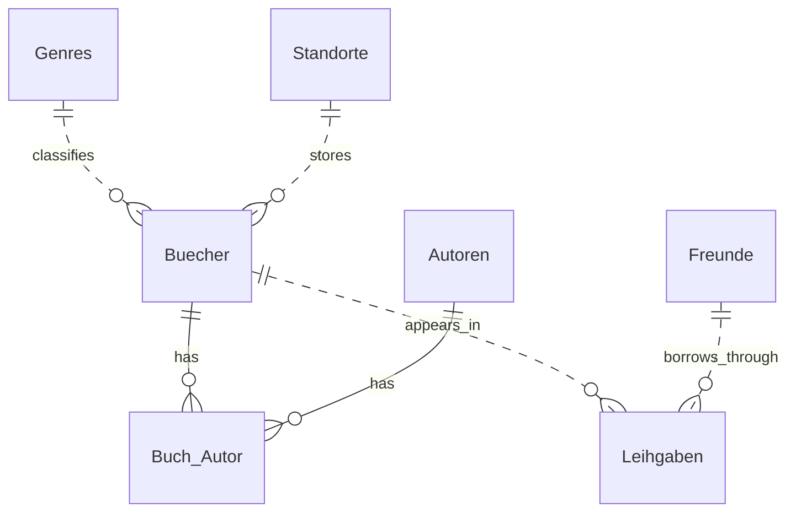

# Liane’s Library

A local Streamlit app for a personal library. Liane can find a book, see who has it, and record a loan or return from the browser. MySQL stores the catalog and loan history.

## Features

| Page | What you can do |
| --- | --- |
| **Overview** | Search by title, borrower, or shelf. Click the catalog, available, active, or overdue count to filter the results. The Active loans table highlights overdue rows in red. |
| **Loans** | Lend an available book to a friend, record a return, or search the loan history by title or borrower. |
| **Books** | Add, edit, or delete a book. Manage its title, ISBN, genre, storage location, authors, and lendable setting. Add a new author directly from the book page. |
| **Friends** | Add, edit, or delete friends and manage their contact details. |
| **Genres** and **Storage locations** | Add, rename, or delete catalog categories and shelf locations. |

## Run locally

### 1. Prepare MySQL

Start MySQL 8. The current connection in `database.py` uses the local server at `127.0.0.1:3306`, the `root` account, and the `lianes_bibliothek` schema.

- If the schema already exists and contains the project tables, proceed to step 2.
- For a fresh setup, open the course schema script `lianes-bibliothek (1).sql` in MySQL Workbench and run it on your local server. Then, if you want demo records, run `beispieldaten (1).sql` once. These SQL files are separate from the Python project folder.

If your local connection uses a different host, port, user, or schema name, update those settings in `database.py`.

### 2. Activate the Python environment

Open a terminal in the folder that contains `app.py`. If you already created the environment for the course, start with `conda activate`.

```sh
conda create -n lianes-lib-env -c conda-forge python=3.12 streamlit sqlalchemy pandas pymysql
conda activate lianes-lib-env
```

### 3. Set the password and start Streamlit

Enter the password for the MySQL account configured in `database.py`. The commands prompt without echoing the password and pass it to Streamlit through the terminal environment.

**Fish**

```fish
read -s -gx -P "MySQL password: " LIANE_MYSQL_PASSWORD
python -m streamlit run app.py --server.address 127.0.0.1
```

**zsh**

```zsh
read -rs 'LIANE_MYSQL_PASSWORD?MySQL password: '
printf '\n'
export LIANE_MYSQL_PASSWORD
python -m streamlit run app.py --server.address 127.0.0.1
```

Open the local URL printed by Streamlit, usually `http://127.0.0.1:8501`. If Python reports `No module named streamlit`, activate `lianes-lib-env` in that terminal and run the command again. If the app cannot load data, check the MySQL server, account, and schema settings.

## Data model

The MySQL schema `lianes_bibliothek` contains seven tables.



### Tables and columns

**PK** means primary key and **FK** means foreign key. Single-column primary keys are auto-incrementing integers. Columns are required unless marked nullable.

| Table | Column | MySQL type | Purpose and constraints |
| --- | --- | --- | --- |
| `Genres` | `GenreID` | `INT` | PK. Genre identifier. |
| `Genres` | `Name` | `VARCHAR(50)` | Unique genre name. |
| `Standorte` | `StandortID` | `INT` | PK. Storage location identifier. |
| `Standorte` | `Bezeichnung` | `VARCHAR(100)` | Unique location label. |
| `Autoren` | `AutorID` | `INT` | PK. Author identifier. |
| `Autoren` | `Vorname` | `VARCHAR(100)` | Author’s first name. |
| `Autoren` | `Nachname` | `VARCHAR(100)` | Author’s last name. The pair `(Vorname, Nachname)` is unique. |
| `Buecher` | `BuchID` | `INT` | PK. Book identifier. |
| `Buecher` | `ISBN` | `VARCHAR(13)` | Nullable. Unique when present. |
| `Buecher` | `Titel` | `VARCHAR(255)` | Book title. |
| `Buecher` | `GenreID` | `INT` | FK to `Genres.GenreID`. |
| `Buecher` | `StandortID` | `INT` | FK to `Standorte.StandortID`. The book’s home location. |
| `Buecher` | `Verleihbar` | `TINYINT(1)` | Whether the book may be lent. Accepts `0` or `1` and defaults to `1`. |
| `Buch_Autor` | `BuchID` | `INT` | FK to `Buecher.BuchID`. Part of the composite PK. |
| `Buch_Autor` | `AutorID` | `INT` | FK to `Autoren.AutorID`. Part of the composite PK. |
| `Freunde` | `FreundID` | `INT` | PK. Borrower identifier. |
| `Freunde` | `Vorname` | `VARCHAR(100)` | Borrower’s first name. |
| `Freunde` | `Nachname` | `VARCHAR(100)` | Borrower’s last name. |
| `Freunde` | `Telefon` | `VARCHAR(30)` | Nullable phone number. |
| `Freunde` | `Email` | `VARCHAR(255)` | Nullable email address. |
| `Leihgaben` | `LeihID` | `INT` | PK. Loan identifier. |
| `Leihgaben` | `FreundID` | `INT` | FK to `Freunde.FreundID`. |
| `Leihgaben` | `BuchID` | `INT` | FK to `Buecher.BuchID`. |
| `Leihgaben` | `Verleihdatum` | `DATE` | Loan date. |
| `Leihgaben` | `Faelligkeitsdatum` | `DATE` | Due date, on or after the loan date. |
| `Leihgaben` | `Rueckgabedatum` | `DATE` | Nullable return date. When set, it must be on or after the loan date. |

### Relationships and lending rules

- Each book has one genre and one home storage location. A genre or location can belong to several books.
- `Buch_Autor` supports multiple authors per book and multiple books per author. Its composite key `(BuchID, AutorID)` prevents duplicate links. Deleting a book or an author removes the corresponding author links.
- Each loan links one book to one friend. Books and friends can have multiple loans over time. Foreign keys protect books and friends with loan history and prevent deletion of genres or locations still assigned to books.
- A loan is active while `Rueckgabedatum` is `NULL` and overdue once its due date has passed. A lendable book with no active loan is available. The app checks for an existing active loan before creating another one for the same book. Recording a return fills in the return date and keeps the loan in the history.

## Code structure

| File | Responsibility |
| --- | --- |
| `app.py` | Streamlit navigation, forms, dashboard, search, and user feedback. |
| `database.py` | Shared SQLAlchemy engine using PyMySQL. |
| `buecher.py`, `autoren.py` | Catalog queries, book writes, and book–author links. |
| `freund.py`, `genres.py`, `standort.py` | CRUD operations for friends, genres, and locations. |
| `leihgaben.py` | Loan creation, returns, history, and overdue calculations. |

## Demo walkthrough

1. With a genre and storage location in place, use **Books** to add a lendable demo book and **Friends** to add a demo borrower.
2. Use **Loans** to record a loan with a due date on or after the loan date.
3. In **Overview**, search for the borrower and confirm that the book shows as **On loan**. Use the **Active loans** card to narrow the results.
4. Record the return. Check that the book shows as **Available** at its home shelf and that the returned loan remains visible under **Loan history**.
